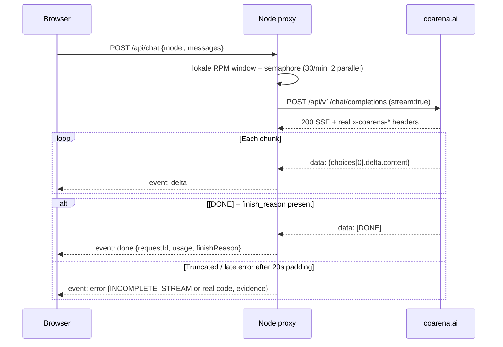

# شبیهساز چت Coarena (رابط کلادمانند)

یک کلاینت چت کاملاً محلی و ماژولار بر اساس **Model API** سرویس `coarena.ai`: بکاند Node.js بدون وابستگی runtime، فرانتاند React 19 + Tailwind CSS 4. کلید API فقط در محیط سرور-process وجود دارد و هرگز وارد مرورگر یا LocalStorage نمی‌شود.

> من قرارداد API را در تاریخ ۲۰۲۶-۱۱-۱۹ از صفحات رسمی خواندهام:
> [Model API docs](https://coarena.ai/docs)، [API reference](https://coarena.ai/developers)،
> [For agents](https://coarena.ai/for-agents) و [OpenAPI 3.1](https://coarena.ai/api/openapi.json).
> تمام اعداد و هدرهایی که در کد آمدهاند، از همان منابع گرفته شدهاند؛ هیچ مقدار ساختگی وجود ندارد.
> نکتهٔ صداقت در مستندات: `openapi.json` سقف پیشفرض رایگان را **$1/day** و صفحهٔ `/docs` آن را **$5/day** نوشتهاند. به همین دلیل کد هیچ عدد دلاری را hardcode نکرده و اعداد واقعی را از `GET /api/v1/limits` میخواند و نمایش میدهد.

---

## ۱. تحلیل پروتکل: نرخ درخواست و هدرهای امنیتی

### ۱.۱ احراز هویت

| مورد | مقدار واقعی بر اساس مستندات |
| --- | --- |
| هدر | `Authorization: Bearer coa_…` (یا `x-api-key`) |
| Scope لازم برای inference | `inference:write` (و `inference:read` فقط برای `/limits`, `/requests`) |
| خطای نبودن شرایط | `403 model_api_terms_required` — باید شرایط در حساب پذیرفته شده باشد |
| طول عمر کلید | ۳۰ / ۹۰ / ۳۶۵ روز؛ باطلشدن در سراسر سرویس ظرف ۱۰ ثانیه |
| محل ساخت کلید | `https://coarena.ai/account/api/keys` |

پروکسی ما کلید را فقط از `process.env.COARENA_API_KEY` میخواند، هنگام startup وجود آن را بررسی میکند و تنها بهصورت `Authorization: Bearer` به upstream میفرستد. مرورگر فقط `/api/*` محلی را صدا میزند.

### ۱.۲ محدودیتهای واقعی و رفتار متناظر در کد

| محدودیت Coarena | مقدار | رفتار ما |
| --- | --- | --- |
| درخواست در دقیقه، per key | ۳۰ | `SlidingWindowLimiter(30, 60_000)` دقیقاً آخرین ۶۰ ثانیه را میشمارد (`server/src/rate-limit.js`) |
| درخواست در دقیقه، per account / account+model | ۳۰ | با تک کاربره بودن پروکسی محلی، همان پنجرهٔ per-key پوشش میدهد |
| تماس همزمان | ۲ | `Semaphore(2)` تمام طول استریم را نگه میدارد، نه فقط تاCONNECT |
| حداکثر ورودی | ۱۲۸٫۰۰۰ توکن | محدودANE طول پیام به ۲۰٫۰۰۰ کاراکتر و حداکثر ۲۰۰ پیام |
| حداکثر خروجی | ۱۶٫۳۸۴ توکن (پیشفرض ۸٫۱۹۲) | `maxTokens` در بکاند بین ۱ و ۱۶۳۸۴ اعتبارسنجی میشود |
| حداکثر بدنه درخواست | ۸ MiB | سقف محلی ۱ MiB |
| سقف abuse محلی | قابل تنظیم | `APP_CLIENT_RPM=20` به ازای IP |

پاسخ ۴۲۹ حاوی `Retry-After` به ثانیه و گاهی `x-should-retry: false` است. سیاست ما:

- `rate_limit_exceeded` / `concurrency_limit_exceeded` → انتظار به اندازهٔ `Retry-After`، سپس retry (حداکثر `COARENA_MAX_ATTEMPTS`).
- `insufficient_quota` (سقف روزانه) → **بدون retry**، چون `x-should-retry: false` است؛ پیام همراه `error.limit_increase` واقعی به UI میرود.
- `401` / `403` / `400` / `402` / `404` / `413` → بدون retry.
- `502` / `503` / `504` → backoff نمایی با jitter کامل.
- تمام انتظارها قابل لغو با `AbortSignal`اند (دکمهٔ Stop واقعاً کار میکند).

### ۱.۳ هدرهایی که از upstream میخوانیم و به UI میرسانیم

| هدر | کاربرد |
| --- | --- |
| `x-coarena-request-id` (یا `request-id`) | امتیازدهی реальный `POST /api/v1/feedback` |
| `x-coarena-model` | مدلی که واقعاً پاسخ داد |
| `x-coarena-substituted-from`, `-to`, `-reason` | Routing ارزانقیمت؛ مدل درخواستی و مدل پاسخدهنده هر دو نمایش داده میشوند |
| `x-coarena-dropped-params`, `x-coarena-emulated` | پارامترهای حذفشده / تقلیدشده توسط upstream |
| `x-ratelimit-*` | باقیماندهٔ واقعی سقفها |
| `Retry-After`, `x-should-retry` | تصمیم retry |
| `Content-Type: text/event-stream` | تشخیص استریم در برابر خطای دیررس |
| `routing`, substitutions | در مدل `x-coarena-*` بالا خلاصه شدهاند |

همچنین Coarena اعلام میکند Conversationها ذخیره میشوند و نباید اطلاعات حساس ارسال شوند؛ این پروژه هیچ دادهای را به جای دیگری ارسال نمیکند و کش LocalStorage فقط روی دستگاه کاربر است.

### ۱.۴ امنیت لایهٔ ما

- کلید در `server/.env` (gitignore شده)، نه در `VITE_*` و نه در مرورگر.
- بدون کوکی → نیازی به CSRF توکن؛ درخواستها JSON و same-originاند. CORS فقط-origin دقیق `APP_ALLOWED_ORIGIN` را در حالت dev میپذیرد؛ wildcard وجود ندارد.
- `APP_ACCESS_TOKEN` اختیاری با مقایسهٔ `timingSafeEqual`สำหรับ استقرار عمومی.
- هدرها: `X-Content-Type-Options: nosniff`، `Referrer-Policy: no-referrer`، `X-Frame-Options: DENY`، `Cross-Origin-Opener-Policy: same-origin`، `Permissions-Policy`، CSP برای HTML، `Cache-Control: no-store` برای API و `X-Accel-Buffering: no` برای SSE.
- HSTS و TLS بر عهدهٔ reverse proxy است (`APP_HOST=127.0.0.1`)؛ نمونهٔ nginx در بخش استقرار.
- محدودکنندهٔ IP محلی از سوءاستفادهٔ پروکسی توسط_other devices جلوگیری میکند.

---

## ۲. کش LocalStorage (بهینه و محدود)

هیچ متن «پیشفرض»ای ذخیره یا نمایش داده نمیشود: محتوای assistant دقیقاً همان_chunks است که upstream فرستاده و در صورت خطا، فیلد `error` با کد واقعی نمایش مییابد.

| کلید | محتوا | TTL / سیاست |
| --- | --- | --- |
| `coarena-chat:v1:index` | خلاصهٔ conversationها | حداکثر ۲۰، مرتب بر اساس `updatedAt` (LRU) |
| `coarena-chat:v1:c:<id>` | پیامها + request_id + usage + خطا | حداکثر ۲۰۰ پیام، ۵۰۰ KB هر conversation، ۱۴ روز |
| `coarena-chat:v1:settings` | مدل انتخابشده و conversationٔ فعال |بدون انقضاء |
| `coarena-chat:v1:models` | لیست مدلهای **واقعی** گرفتهشده از `/models` | ۱ ساعت، سپس دوباره از API |

رفتارها:

1. **نوشتن هنگام تثبیت turn**، نه به ازای هر token استریم (جلوگیری از تخریب UI).
2. **QuotaExceededError** → قدیمیترین conversationها حذف میشوند، سپس cache مدلها؛ اگر باز هم جا نبود خطای `STORAGE_QUOTA` با جزئیات به نمایشگر میرود.
3. **Schema version** (`v1`) و بررسی ساختار: ورودی خراب → `STORAGE_CORRUPT` و پاک شدن همان کلید.
4. **TextEncoder** برای شمارش دقیق بایت، نه تعداد کاراکتر.
5. کلید API، توکنها، وcke استریم ناقص هرگز نوشته نمیشوند.

---

## ۳. معماری سیستم

```mermaid
flowchart LR
    B[Browser: React 19 + Tailwind 4] -->|relative /api/* JSON + SSE| P[Node 22 proxy :8787]
    P -->|static build| B
    P -->|Authorization: Bearer coa_… (server env only)| C[coarena.ai /api/v1]
    B <-->|versioned v1 keys, LRU, TTL| L[(LocalStorage)]
    C -->|GET /api/v1/models| P
    C -->|GET /api/v1/limits| P
    C -->|x-coarena-request-id / x-coarena-model / x-ratelimit-* / Retry-After| P
    P -->|typed SSE events| B
```



---

## ۴. نقشهٔ کد

```
chat-simulator/
├── server/                      # Node.js, صفر dependency در runtime
│   ├── .env.example             # مقادیر واقعی و قابل تنظیم
│   ├── src/config.js            # بارگذاری و fail-fast متغیرها
│   ├── src/errors.js            # UpstreamError / IncompleteStreamError + Retry-After
│   ├── src/rate-limit.js        # sliding window + semaphore + sleep+jitter
│   ├── src/sse.js               # SSE framer/parser با نادیدهگرفتن keepalive
│   ├── src/coarena-client.js    # adapter: models, limits, feedback, chat stream
│   ├── src/app.js               # routing, validation, CORS, security headers, static
│   ├── src/index.js             # bootstrap
│   └── test/                    # 6 تست قرارداد با upstream جعلی
└── web/                         # React 19 + Vite 7 + Tailwind 4
    ├── src/lib/api.js           # fetch + SSE consumer + ApiError
    ├── src/lib/storage.js       # LocalStorage cache با JSDoc کامل
    ├── src/components/          # Sidebar, Message, Composer, ErrorPanel
    ├── src/App.jsx              # state و جریان استریم
    └── test/storage.test.js     # 5 تست کش، LRU و quota
```

تمام توابع JS دارای JSDocاند (`@param`, `@returns`, `@typedef`). معادل آن در Python، docstring است؛ در این پیادهسازی بکاند عمداً Node.js انتخاب شد تا JSDoc در هر دو طرف یکسان باشد.

---

## ۵. مدیریت خطا؛ بهخصوص پاسخ ناقص

Coarena بعد از ۲۰ ثانیه پاسخ را با وضعیت ۲۰۰ قطع میکند و با newlineهای خالی زنده نگه میدارد؛ خطای بعد از آن **در بدنه** میآید. به همین دلیل وضعیت HTTP بهتنهایی معیار موفقیت نیست.

| موقعیت | کدی که به کاربر نشان داده میشود | شواهد همراه |
| --- | --- | --- |
| 401/403/404/400/402 | همان `error.code` واقعی مثلاً `invalid_api_key` | `httpStatus`, `requestId`, `message` واقعی upstream |
| 429 قابل retry | `rate_limit_exceeded` / `concurrency_limit_exceeded` | `retryAfterMs`, `retryable`, `x-ratelimit-*` |
| 429 سقف روزانه | `insufficient_quota` | `limit_increase` واقعی برای درخواست افزایش سقف |
| خطای درون استریم بعد از ۲۰۰ | همان code واقعی مثلاً `upstream_timeout` | `doneSeen`, `finishReason`, `chunks`, `bytes`, `elapsedMs` |
| استریم تمامشده بدون `[DONE]`/بدون `finish_reason` | `INCOMPLETE_STREAM` | تمام شواهد بالا + `malformedFrames`, `readError` |
| `finish_reason=length` | هشدار `OUTPUT_TRUNCATED` | `finishReason`, `maxTokens` واقعی درخواست |
| `finish_reason=content_filter` | هشدار `CONTENT_FILTERED` | `finishReason`, `requestId` |
| localStorage پر | `STORAGE_QUOTA` | تعداد حذفها و کلید هدف |

هیچ پیام «من نمیتوانم پاسخ دهم» ساخته نمیشود؛ `message` یا از `error.message` upstream میآید یا توصیف فنی وضعیت استریم است.

---

## ۶. استقرار مرحلهمرحله

### الف) محلی

```bash
cd chat-simulator/server
cp .env.example .env
# COARENA_API_KEY را از https://coarena.ai/account/api/keys وارد کن
# شرایط Model API را همانجا بپذیر، وگرنه 403 model_api_terms_required میگیری
npm test

cd ../web
npm install
npm test
npm run build
```

حالت development (دو ترمینال):

```bash
# ترمینال ۱
cd chat-simulator/server
APP_ALLOWED_ORIGIN=http://127.0.0.1:5173 npm run dev

# ترمینال ۲
cd chat-simulator/web
npm run dev
# http://127.0.0.1:5173
```

حالت production تکپروسهای (همان origin):

```bash
cd chat-simulator/server
npm start          # web/dist را هم سرو میکند
# http://127.0.0.1:8787
```

### ب) سرور با TLS (systemd + nginx)

1. ساخت کاربر و کپی فایلها در `/opt/chat-simulator`؛ مالکیت `chatsim`.
2. پر کردن `/opt/chat-simulator/server/.env` و اطمینان از `APP_HOST=127.0.0.1`.
3. واحد systemd:

```ini
[Unit]
Description=Coarena chat simulator proxy
After=network.target

[Service]
Type=simple
User=chatsim
WorkingDirectory=/opt/chat-simulator/server
ExecStart=/usr/bin/node --env-file=.env src/index.js
Restart=on-failure

[Install]
WantedBy=multi-user.target
```

```bash
systemctl daemon-reload && systemctl enable --now chat-simulator
journalctl -u chat-simulator -f
```

4. nginx (SSE نباید بافر شود و HSTS فقط روی HTTPS):

```nginx
server {
    listen 443 ssl;
    server_name chat.example.com;

    ssl_certificate     /etc/letsencrypt/live/chat.example.com/fullchain.pem;
    ssl_certificate_key /etc/letsencrypt/live/chat.example.com/privkey.pem;
    add_header Strict-Transport-Security "max-age=31536000; includeSubDomains" always;

    location / {
        proxy_pass http://127.0.0.1:8787;
        proxy_http_version 1.1;
        proxy_set_header Host $host;
        proxy_set_header X-Forwarded-For $proxy_add_x_forwarded_for;
        proxy_buffering off;
        proxy_cache off;
        proxy_read_timeout 300s;
    }
}
```

5. اگر پروکسی عمومی است، `APP_ACCESS_TOKEN` را پر کنید و توکن را در فیلد `app token` بالای رابط وارد کنید. توکن در `sessionStorage` نگه داشته میشود (نه LocalStorage) و بهصورت `x-app-token` ارسال میشود. برای نیازهای قویتر، احرازهویت را در nginx قرار دهید.

### ج) بررسی سلامت

```bash
curl -s http://127.0.0.1:8787/api/health
curl -s http://127.0.0.1:8787/api/models
curl -s http://127.0.0.1:8787/api/limits
curl -N -X POST http://127.0.0.1:8787/api/chat \
  -H 'Content-Type: application/json' \
  -d '{"model":"<< مدل واقعی از /api/models >>","messages":[{"role":"user","content":"Hello"}]}'
```

### د) عیبیابی

| نشانه | دلیل واقعی | اقدام |
| --- | --- | --- |
| `403 model_api_terms_required` | شرایط Model API پذیرفته نشده | در حساب Coarena بپذیرید |
| `401 invalid_api_key` / `api_key_expired` | کلید نامعتبر/منقضی | کلید جدید بسازید و `.env` را بروزرسانی کنید |
| `402 payment_required` / `insufficient_quota` | سقف روزانه یا مدل غیررایگان | عدد واقعی `/api/limits` را ببینید، مدل رایگان انتخاب یا credit اضافه کنید |
| `429 concurrency_limit_exceeded` | بیش از ۲ تماس همزمان | `COARENA_MAX_CONCURRENCY` را زیاد نکنید؛ صف داخلی صبر میکند |
| `INCOMPLETE_STREAM` | upstream بدون `[DONE]` بسته شد | جزئیات `event: error` را ببینید؛ `COARENA_TIMEOUT_MS` را براساس طول پاسخ تنظیم کنید |
| `ORIGIN_NOT_ALLOWED` | dev origin با `APP_ALLOWED_ORIGIN` فرق دارد | Origin دقیق Vite را وارد کنید |
| `NO_STATIC_BUILD` | `web/dist` ساخته نشده | `npm run build` در `web/` |

---

## ۷. محدودیتها

- فقط متن (بدون image/tool call). Coarena از اغلب مدلها تصویر هم میپذیرد، اما رابط ما فعلاً sanitation متن انجام میدهد.
-rowse conversationها فقط در همان مرورگرند؛ بین دستگاهها sync وجود ندارد (عمداً، به دلیل حریم خصوصی).
- `GET /api/v1/models` بدون کلید است؛ لیست مدلها هر ۱۰ دقیقه در سرور تازه میشود و در مرورگر ۱ ساعت کش میماند.
- Coarena متن درخواستها و پاسخها را ذخیره میکند؛ از ارسال اطلاعات حساس خودداری کنید.
